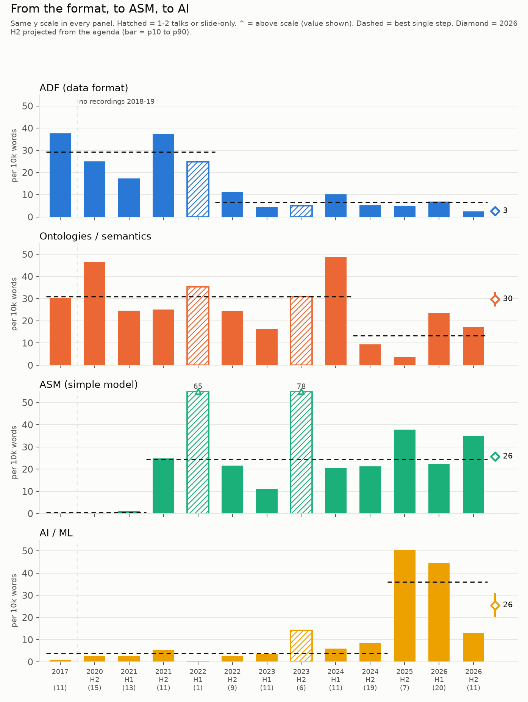
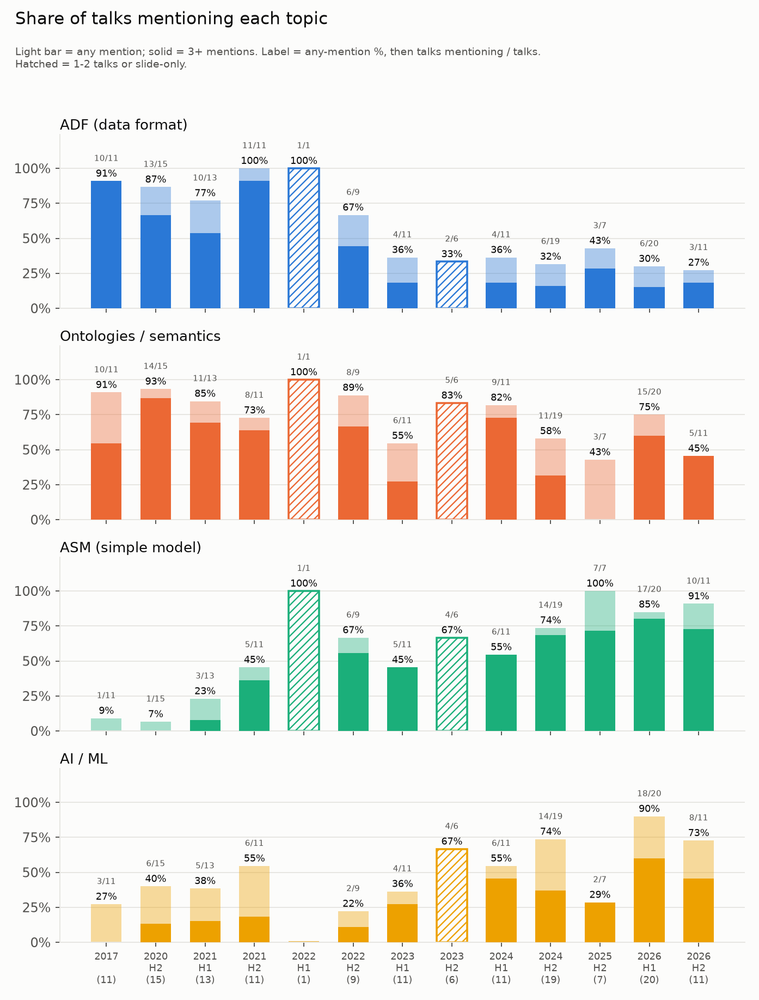
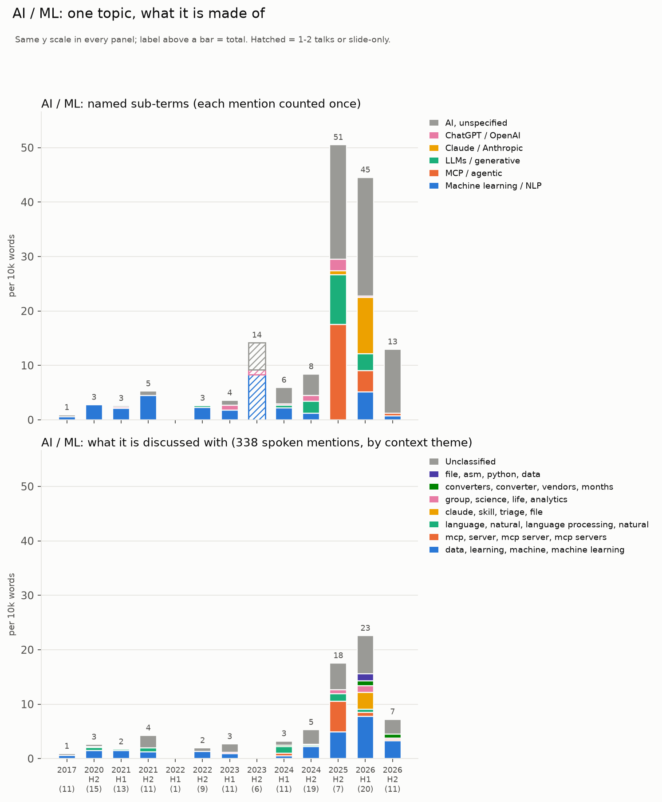
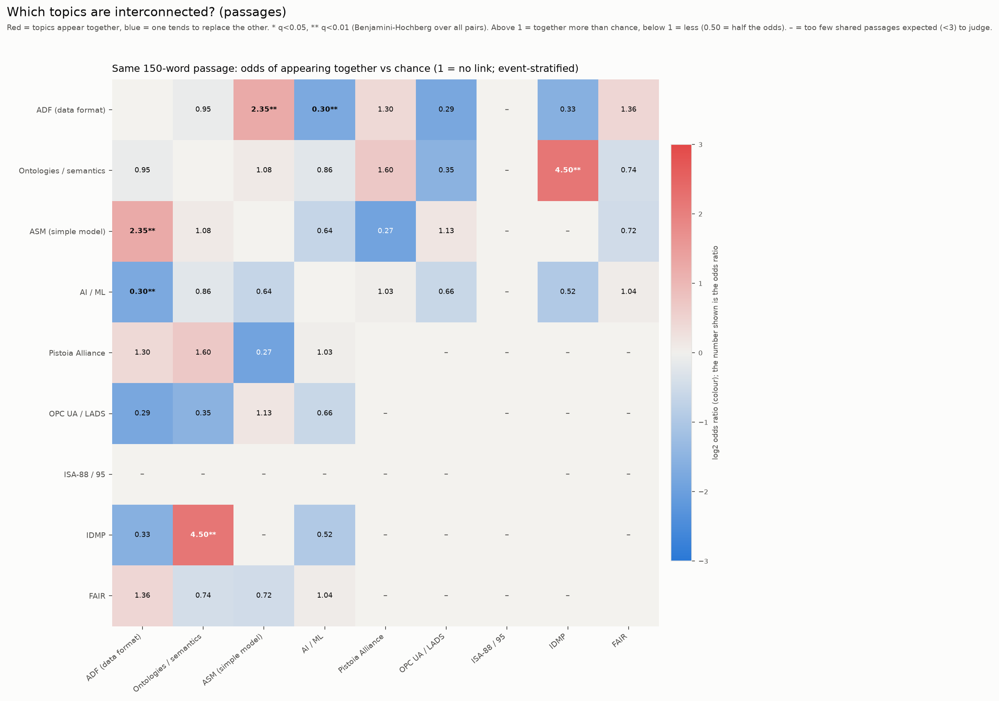
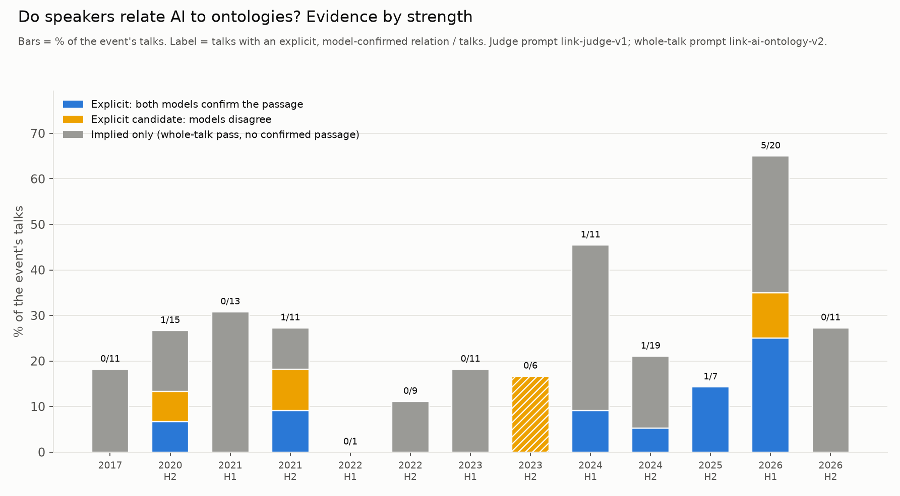
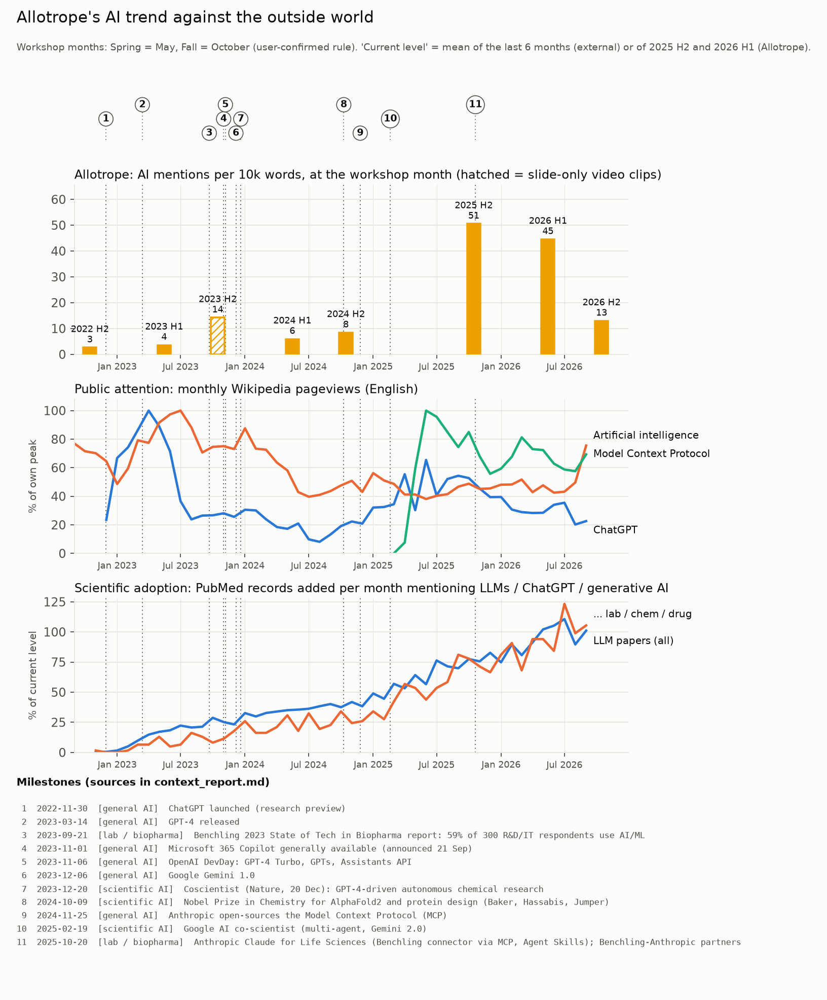

# ytscribe

Turn YouTube videos, playlists and channels into transcripts, then study how the topics in them change over time.

It started as a transcript grabber for the public Allotrope Connect workshop videos and grew into a small research pipeline:

1. **Get the text.** Use a video's own captions when they exist; otherwise transcribe locally with Whisper (or the Mistral API). Videos that are just slides get their slide text read with OCR.
2. **Keep it traceable.** Everything goes into SQLite plus per-video files, with the playlist, event, upload date, duration and chapters attached.
3. **Analyse it.** Word-level topic trends, statistics, topic discovery, and an LLM layer that checks claims against exact quotes.

> **This repository contains code only.** No transcripts, videos or databases are included (`data/` is git-ignored). You generate them yourself, from videos you are entitled to process, and you are responsible for respecting YouTube's terms and the rights of the channel owners.

Built with [Claude Code](https://claude.com/claude-code), with a human directing every design decision and reviewing the results.

---

## What it does

| Stage | Command | What happens |
|---|---|---|
| Register | `ys add <url \| source.yaml>` | Enumerate a video, playlist or channel with yt-dlp (nothing is downloaded). |
| Transcribe | `ys fetch` | Manual captions, then auto captions, then `youtube-transcript-api`, then local Whisper. Resumable, rate-limit aware, never crashes the batch. |
| Metadata | `ys enrich` | Upload date, description, chapters, views; playlist id/name; event year and half. |
| Slides | `ys slides` | For slide-only videos: ffmpeg frames, `imagehash` change detection, Apple Vision OCR. |
| Inspect | `ys status`, `ys list`, `ys catalog` | Status table, one row per video (CSV and JSONL), sorted by date. |
| Analyse | `ys topics …` | Trends, changepoints, distinctive terms, breakdowns, correlation, outside-world context. |
| LLM | `ys llm …` | Focused per-talk and per-passage questions with verified quotes; taxonomy and gold-label tooling. |

Engineering points worth knowing:

- **yt-dlp heals itself.** On an extractor failure it upgrades itself in the venv, reloads and retries once per run (never for private or removed videos).
- **Logging is extensive:** console, a daily DEBUG file and structured JSONL, with `video_id`, `stage` and `attempt` on every line.
- **Local models are quantized** (Whisper q4/q8). The ASR backend is pluggable (`whisper` default, `mistral` opt-in).
- **Audio is prefetched** for the next video that will need ASR while the current one is processed.
- **Low-content transcripts are flagged** (for example Whisper's "Thank you." on silence) and trigger slide extraction.

## Quick start

Requirements: Python 3.11–3.12, [uv](https://docs.astral.sh/uv/), `ffmpeg`. Apple Silicon is needed for the local Whisper (`mlx-whisper`) and the OCR (`ocrmac`, Apple Vision); everything else is portable.

```bash
git clone https://github.com/fredbuildsai/ytscribe && cd ytscribe
uv sync --extra dev --extra analysis        # core + analysis; see "Extras" below
uv run pytest -q                            # 78 tests (2 need the optional `llm` extra and are skipped without it)

uv run ys add https://www.youtube.com/playlist?list=<ID>   # or: configs/sources/allotrope.yaml
uv run ys fetch --limit 3                   # captions first, ASR fallback
uv run ys status
```

Outputs: `data/ytscribe.db` (SQLite), `data/transcripts/<video_id>/{meta.json,transcript.json,.srt,.txt}`, `data/catalog.csv`, logs in `logs/`.

**Extras** (`uv sync --extra …`): `asr` (mlx-whisper), `mistral`, `slides` (Pillow, imagehash, ocrmac), `analysis` (pandas, scikit-learn, ruptures, scattertext, statsmodels, rapidfuzz, matplotlib), `sentiment` (VADER), `topics` (BERTopic, sentence-transformers; pulls in torch), `llm` (see below), `dev`.

**LLM layer.** `ys llm …` uses [llmrouter-free](https://github.com/fredbuildsai/llmrouter-free) (free-tier cloud models first, local Ollama as fallback), installed from its GitHub tag with `uv sync --extra llm`. Put `OPENROUTER_API_KEY` in `.env` (git-ignored), or point `YS_LLM_ENV_FILE` at an existing `.env`; only that one variable is ever read from it. Without a cloud key it falls back to a local Ollama model. Without the `llm` or `analysis` extras, `ys` still works and `ys llm` / `ys topics` tell you what to install.

## Configuration

| File | Purpose |
|---|---|
| `configs/default.yaml` | Caption policy, ASR backend/quantization, yt-dlp retries, slide-extraction thresholds. |
| `configs/sources/*.yaml` | A channel plus a playlist-title filter (the Allotrope one matches "Allotrope Connect"). |
| `configs/topics/allotrope.yaml` | Topic lexicons (regex with fuzzy matching for caption garbling), groups, thresholds. |
| `configs/topics/context_allotrope.yaml` | Dated external milestones, **each with a source URL**, plus the workshop-month rule. |
| `configs/topics/taxonomy_categories_v1.yaml` | Proposed grouping of discovered themes into 17 categories. |
| `configs/llm_routes.yaml` | LLM routes and deployments. |

---

## Example application: Allotrope Connect

The first use case: all 17 "Allotrope Connect" workshop playlists on the Allotrope Foundation channel. 146 videos registered; **145 transcribed** (about 53 hours, 0.5 million words); 1 is private. Of the 145: 135 from auto-captions, 5 with Whisper (4 speech, 1 mixed), 5 slide-only videos read with OCR.

The question: **how do the content and direction of the discussions evolve, and where does AI fit?**

### Direction of the workshops

Mentions per 10,000 words, per workshop. One topic per panel, all on the same scale.



- **ADF fades.** From about 17–37 per 10k words (2017–2021) to about 5 since 2023.
- **ASM arrives** in 2021 H2 and then runs at roughly 20–38 per 10k words (one dip to 11 in 2023 H1).
- **AI becomes central in 2025 H2.** The AI topic is deliberately one topic made of many parts (generic AI terms plus Claude, MCP, ChatGPT and other named products). 2025 H2 rests on 7 talks and is carried by 2 of them, so the share of talks is the more robust view:



- Events are labelled **H1/H2** (Spring = May/June, Fall = October). The 2026 H2 event has only 11 of about 22 sessions uploaded; a projection from the published agenda (validated on the sessions that exist in both forms) fills the gap, and is plotted as a separate marker.

### What is AI made of?



### Are AI and ontologies interconnected?

Tested three ways, with the time trend and talk length controlled for:

- **By words:** no. Talk-level correlation about −0.1; passage-level odds ratio 0.86 (95% CI 0.6–1.2).
- **By an LLM judging short passages** (two different model families; a relation counts only if both agree and quote it): **yes, but concentrated.** 10 of 145 talks, 5 of them in 2026 H1.




The first LLM pass (whole talk) **over-claimed**: it labelled 40 of the 85 talks it assessed as connected, mostly by inference, with quotes that did not state the relation. That is why the pipeline checks each claim against exact quotes and uses a second, independent judge. See [How the LLM layer is kept honest](#how-the-llm-layer-is-kept-honest).

### Early, on time or late?



Against public attention (Wikipedia pageviews) and scientific adoption (PubMed records mentioning LLMs), with dated, sourced milestones: **late** against public attention, **roughly on time** with the lab-and-biopharma wave, and **quick** to react to concrete lab-AI products (MCP, Claude for Life Sciences). A 3–6 month "work done before the talk" sensitivity is in `ys topics context-lag`.

These are results of one worked example, with the limits below.

---

## Methods, in short

- **Topic lexicons** use neutral terms only (names, acronyms, technologies), never subjective words. Tone is measured separately by sentiment on the text around each mention, so the two cannot contaminate each other. Fuzzy matching (`regex`) absorbs auto-caption garbling ("pistolia", "chat gbt").
- **Existing libraries first.** Changepoints with `ruptures`; distinctive terms with Fightin' Words log-odds (`scattertext`); topic discovery with BERTopic; statistics with `scipy`/`statsmodels`; OCR with Apple Vision; image change detection with `imagehash`. Hand-written code is limited to the policy decisions on top.
- **Association** is measured at talk level (Spearman, pooled and within event) and passage level (odds ratios, Mantel-Haenszel stratified by event, Benjamini-Hochberg over all pairs). A test pins the key confound: two topics that only share a time trend look linked when pooled and are not when stratified.
- **Projection for incomplete events** learns, from other events, how a topic in a session *title* shifts the transcript rate, then applies it to sessions without video. Validated on the sessions that have both.
- **No LLM until the deterministic baseline exists**, and a human-approved taxonomy before any LLM labelling.

### How the LLM layer is kept honest

- Every claim needs an **exact quote**, checked mechanically against the transcript. The match threshold was calibrated on real data: faithful but trimmed quotes score 76–95, invented same-topic quotes about 50.
- A claim without a verifying quote is **rejected and retried**, not stored.
- Quote *existence* is not enough (a sentence can exist and say nothing relevant), so a second stage judges short passages **independently with two model families**; only agreement counts.
- The model sees only the transcript or passage, **never the keyword counts**, so it is an independent check.
- The exact prompts are in [`docs/prompts/`](docs/prompts) (whole-talk v2, passage judge v1) and `ys llm show-prompt`.
- Humans label a gold set (`data/gold/link_gold_review.html`, generated), and `ys llm gold-eval` scores each judge against it.
- The reviewer-fill taxonomy has every key you must set as `null`; the loader refuses an incomplete or unapproved file.

## Limits you should know

- **Auto-captions are noisy**: names are garbled and fillers remain. The lexicons compensate, but counts are lower bounds.
- **Thin events**: 2022 H1 is one talk; 2023 H2 is six short slide-only clips; 2025 H2 is seven talks. They are drawn hatched and kept out of step fits.
- **Word counts are not meaning.** The LLM stage exists for that, and it is only as good as the models and the labels checked against it.
- **Timing resolution is coarse**: workshops are six months apart (and there is a 12-month gap in 2025), so lag estimates are intervals, not points.
- **Correlation is not influence.** Matching events to workshops shows association, not cause.
- **Event dates** use a May/October rule confirmed by the author; only some are confirmed from sources.
- Some external sources blocked automated fetching, so a few milestone dates rely on secondary coverage (marked in the config).

## Layout

```
src/ytscribe/
  cli.py, pipeline.py, captions.py, audio.py, video.py, slides.py, export.py, quality.py
  ytdlp_runner.py (self-healing yt-dlp)  logging_setup.py  settings.py
  asr/ (whisper, mistral, chunking)  db/ (SQLAlchemy models)  sources/ (resolver)
  analysis/ (lexicon, trends, terms, projection, breakdown, association, context, discover, charts, sentiment, cli)
  analysis/llm/ (client, link, judge, verify, taxonomy, reports, cli)
configs/   tests/ (78)   docs/ (prompts, images, ROADMAP.md)   scripts/spikes_2026-10-15/ (superseded experiments)
```

## Roadmap

See [`docs/ROADMAP.md`](docs/ROADMAP.md): a simple HTML tool to configure a new topic (design to be decided); per-talk LLM annotation on the approved taxonomy; stance and partnership analysis; call-for-abstract dates to tighten the lag estimates.

## License

No license file yet, so by default all rights are reserved. Add one before inviting reuse.
